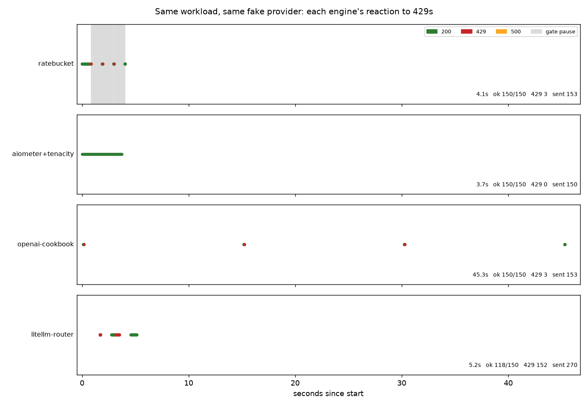

# ratebucket

**An async resource arbiter for APIs that enforce several rate limits at once.**

A semaphore bounds concurrency. A rate limiter bounds speed. Most API clients confuse the
two, and almost none handle *two* limits together: requests-per-minute and
tokens-per-minute are enforced at the same time, and a permit has to be granted against
both or neither. `ratebucket` treats a provider's quota as a resource to be reserved,
reconciled and returned -- across every dimension, from one arbiter, with a single
pool-wide reaction to 429.

LLM batches are the first example, not the subject. The core does not know the word: an
`http_fetch` adapter drives the same arbiter with a cost of one request and no notion of
tokens. The `openai_compat` adapter is just its first user.

> **Why not the provider's Batch API?** It is a 24-hour SLA, and half the
> OpenAI-compatible providers do not offer a batch endpoint at all -- self-hosted vLLM has
> none. `ratebucket` is for the online case: you need the answers now, and you need to stay
> under the limit while getting them.

```bash
pip install ratebucket
```

Typed (`py.typed`, checked with `mypy --strict`), no required dependencies beyond the
standard library, Python 3.11-3.13.

## What it looks like under load

The same 150-request batch through four engines against the same fake provider (in this
repository, on localhost), each told the same rate limit. Reproduce with `make bench`; the
numbers are in [`bench/results.json`](bench/results.json).



The two rows to compare both met **three** 429s. ratebucket spent 0.3 seconds on them; the
openai-cookbook reference script spent forty-one. The cookbook holds a single global pause
keyed on the timestamp of the *last* 429 it saw, re-read at the top of its loop, so one
stray 429 -- even from a request already in flight -- freezes the whole pool for a hardcoded
15 seconds, and a later 429 drags that deadline forward again. ratebucket's gate carries an
epoch, so a 429 pauses only the wave it belongs to and honours the provider's `Retry-After`.

Honest losses, measured on the same run (fake provider, localhost, not production):

- **aiometer + tenacity is 0.3s faster here.** On a single-limit workload that fits inside
  one `max_per_second`, it paces perfectly and meets no 429s, so there is nothing for a
  pool-wide gate to improve. That case does not need what ratebucket is for: two limits at
  once, reserve-and-reconcile, one pause for the whole pool.
- **LiteLLM's Router finished 118 of 150.** It is a load balancer for routing around busy
  *deployments*; pointed at a single one it bursts, storms, and drops the overflow.

## Quick start

```python
import asyncio, os, random
import httpx
from ratebucket import Gate, MultiResourceLimiter, RealClock, RetryPolicy, TokenBucket
from ratebucket.adapters.openai_compat import OpenAICompatClient

async def main() -> None:
    clock = RealClock()
    # Two limits at once. per_minute sizes capacity below the limit (ADR 0003) so a
    # fixed-window server does not see a rolling-minute burst of nearly twice the rate.
    limiter = MultiResourceLimiter(
        {
            "requests": TokenBucket.per_minute(3_500, clock),
            "tokens": TokenBucket.per_minute(90_000, clock),
        },
        clock,
    )
    limiter.start()
    gate = Gate(clock)                        # one 429 pauses the whole pool, once
    retry = RetryPolicy(clock, random.Random())

    prompts = [f"Summarise document {i}." for i in range(500)]
    async with httpx.AsyncClient(
        base_url="https://api.openai.com",
        headers={"Authorization": f"Bearer {os.environ['OPENAI_API_KEY']}"},
        timeout=httpx.Timeout(60.0, connect=5.0),
    ) as http:
        client = OpenAICompatClient(http, limiter, gate, retry, clock, model="gpt-4o-mini")
        answers = await asyncio.gather(
            *(client.complete([{"role": "user", "content": p}], max_tokens=256)
              for p in prompts)
        )
    await limiter.aclose()
    print(len(answers), "done")

asyncio.run(main())
```

Fire all 500 at once. The arbiter paces them under both limits, the gate absorbs any 429
for the whole pool at once, and each reservation reconciles its estimated token cost
against the `usage` the provider actually reports.

```bash
make bench    # the plot above, from four engines. No keys, no money, no network.
```

## How it works

```
   many callers                    one arbiter coroutine (owns the buckets)
  +-----------+   reserve(cost)   +--------------------------------------+
  | complete()| ----------------> |  FIFO queue of (cost, future)        |
  | complete()|                   |  looks only at the head;             |
  |    ...    | <---- granted --- |  grants it across EVERY dimension    |
  +-----------+                   |  at once, or waits                   |
        |                         +---------------+----------------------+
        | 429 (any worker)                        | take / give_back
        v                          +--------------v---------------+
   +---------+  epoch              |  requests bucket   tokens bucket
   |  Gate   |  compare-and-swap   |  continuous lazy refill; level may go < 0
   +---------+  one pause / pool   +------------------------------+
```

- **TokenBucket** -- one quota dimension. Refill is continuous and lazy (the level is a
  function of time, not a background timer), because a once-a-minute top-up bursts at the
  window boundary and breaks the bound `permits(W) <= capacity + rate*W`. The level may go
  negative, so an over-spend is recorded rather than clamped away and under-counted.
- **MultiResourceLimiter** -- one arbiter coroutine owning a FIFO queue. It grants the head
  across *all* dimensions atomically or not at all, which makes the two-limit case
  deadlock-free by construction: there is no state where one resource is held while another
  is awaited. Head-of-line blocking is addressed by conservative backfilling (off by
  default, behind a flag).
- **Reservation** -- reserve by an upper bound before the request, `commit(actual)` against
  reported usage after. A failure between the two releases the whole reservation, so quota
  is never leaked for good.
- **Gate** -- the pool-wide reaction to 429. It carries an epoch; a 429 closes the gate for
  its epoch, and the other forty-nine concurrent 429s, being of the same epoch, are stale
  and do not re-close it. Fifty 429s, one pause.
- **RetryPolicy** -- classifies each failure and defers throttling to the gate. Full-jitter
  backoff, with an injected `Random` for reproducibility.

## Design decisions

Each of these has an ADR in [`docs/adr/`](docs/adr/) with the alternatives that were
rejected and why.

- **[0003](docs/adr/0003-bucket-capacity-below-rpm.md) -- capacity below the limit, not
  equal to it.** A bucket sized at the full RPM can grant nearly `2*RPM` in a rolling minute
  against a fixed-window server. Default capacity is `RPM/6` (ten seconds of burst); the
  rate stays at the real limit, so only burst depth is capped.
- **[0002](docs/adr/0002-single-fifo-arbiter-and-backfilling.md) -- a single FIFO arbiter,
  and conservative backfilling.** One arbiter granting atomically is deadlock-free by
  construction; backfilling (from HPC schedulers) fills the head-of-line gap without ever
  delaying the head, proven to the nanosecond.
- **[0004](docs/adr/0004-hand-written-retry-and-the-shared-gate.md) -- a hand-written retry
  over a shared gate, not tenacity.** tenacity retries inside one coroutine and cannot tell
  the other 199 to slow down; the pool-wide reaction has to live somewhere tenacity cannot
  reach.
- **[0005](docs/adr/0005-token-estimation.md) -- a dependency-free token estimate by
  default.** `chars / 4`, with `tiktoken` an optional extra behind a Protocol.
  Reserve-and-reconcile absorbs the error.
- **Epochs in two places** -- the gate (concurrent 429s collapse to one pause) and the
  `x-ratelimit-*` header fold (a header from an earlier request cannot overwrite a fresher
  one). Same idea: an observation stamped with when it happened, ignored if a newer one has
  already won.

### What each failure does

| Failure | Class | Action |
|---|---|---|
| `2xx` | OK | done |
| `429` | THROTTLED | close the pool-wide gate for `Retry-After`; **not** a spent retry |
| `500`-`599`, `408` | RETRYABLE | full-jitter backoff, then retry |
| connect timeout, connection refused | RETRYABLE | it never reached the server; safe to retry |
| read timeout, body dropped mid-stream | AMBIGUOUS | may have been executed and billed; **not** retried by default |
| `400`, `404`, other `4xx` | PERMANENT | fail this one task, not the run |
| `401`, exhausted deadline | FATAL | abort the whole run |

## Limitations

Deliberately, and named here before a reviewer names them:

- **Double-pay risk on an ambiguous failure.** A read timeout or a mid-stream drop may have
  been executed and billed. The default does not retry it (paying twice is worse than
  missing one answer) and releases its reservation, which leaves the bucket briefly
  optimistic until the next response's `x-ratelimit-*` headers correct it. Set
  `retry_ambiguous=True` if your requests are idempotent.
- **The reservation blocks its upper bound for the length of the request.** A prompt that
  reserves 4000 tokens and uses 20 has kept 3980 out of the pool until it commits. A tighter
  estimator (the `tiktoken` extra) narrows the gap; it cannot close it, because the true
  cost is not known until the reply.
- **Head-of-line blocking in the extreme.** The FIFO arbiter can park small requests behind
  one huge one. Conservative backfilling addresses it but is off by default; a pathological
  mix of costs can still stall.
- **No persistence, no distribution.** State is in-process. Two processes do not share a
  limiter, and a restart forgets the buckets. That is a deliberate boundary for v0.1, not an
  oversight -- it is the door to a distributed rate limiter, and a different project.

### Why not something off the shelf

- **aiolimiter** -- one leaky bucket, one dimension. No requests-*and*-tokens together, no
  reserve-and-reconcile, no shared 429 reaction.
- **aiometer** -- paces the launch rate well, but knows nothing of a second limit or of
  token cost, and a 429 is yours to handle.
- **tenacity** -- excellent per-call retry, but each call backs off alone; it has no way to
  pause the pool, which is the entire point of the gate.
- **the openai SDK** -- retries and respects `Retry-After` per request, but does not pace
  you under a rate limit or reserve a token budget across a batch.
- **the provider's Batch API** -- 24-hour SLA, and absent from half the OpenAI-compatible
  providers and from self-hosted vLLM (see the top of this file).
- **the openai-cookbook parallel processor** -- the closest prior art, and the benchmark
  above is what happens to its global pause under a handful of 429s.

## Tests

```bash
make check           # ruff, mypy --strict on 3.11/3.12/3.13, the full suite, core purity
uv run pytest -q     # ~0.5s for the deterministic core; the network tests use a real socket
```

The core is tested on a virtual clock and an injected `Random(seed)`: deterministic, and
faster than a second for the whole invariant sweep. The marquee tests are
`test_permits_bounded_by_capacity_plus_rate_times_window` (a property test over a hundred
random schedules) and `test_fifty_concurrent_429_produce_single_pause`.

Every proof-test is required to go **red** when its fix is removed -- a happy-path test that
passes no matter what proves nothing. Each one's failure without its fix is demonstrated,
with the exact edit and the `pytest` output, in [`WORKLOG.md`](WORKLOG.md). `make prove`
walks the two headline invariants live: ratebucket's mechanism against the naive version it
replaces, side by side, so you can see the bound hold and then break.

## License

MIT. See [LICENSE](LICENSE). The vendored benchmark script under `bench/vendor/` keeps its
own MIT licence from the openai-cookbook project.
